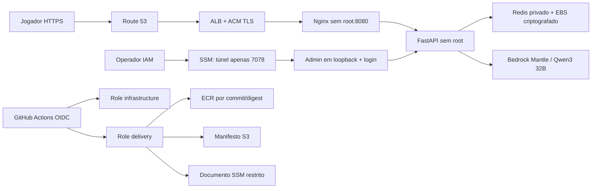

# Deploy AWS: base pronta, ativação manual

## Arquitetura e escopo



Domínio: **memoriaslicantropicasgame.gustavodreis.dev.br**. DNS não distingue a capitalização solicitada em `MemoriasLicantropicasGame`.

A aplicação usa uma EC2 **m7i-flex.large**, Amazon Linux 2023 x86_64, sem chave SSH e sem entrada na porta 22. O ALB recebe 80 para redirecionar a 443; só seu security group alcança 8080 na EC2. A instância tem IPv4 público para sair a ECR/SSM/Mantle e instalar atualizações, mas não aceita conexões públicas diretas ao jogo, API, Redis ou admin. A rede existente é reutilizada; não há NAT Gateway, criação/remoção de VPC ou mudanças na zona DNS de outro projeto.

Dois roots Terraform:

- `infra/terraform/bootstrap`: base persistente — S3 de state e manifests com versionamento/TLS/criptografia, ECR imutável com scan, zona DNS dedicada, certificado ACM/CNAME de validação, EBS gp3 criptografado, papéis IAM, documentos SSM. Recursos de dados/state têm `prevent_destroy`.
- `infra/terraform/app`: ambiente que o workflow pode subir/destruir — EC2, attachment do volume, ALB/listeners/target group, security groups e registro A. Destruir este root **preserva dados do Redis, certificado, zona, imagens, roles e state**. A base persistente continua podendo gerar custos de DNS/armazenamento.

Esta entrega não executou apply/destroy, não criou recursos AWS, não alterou DNS e não publicou workflows no GitHub. As consultas AWS feitas foram somente de leitura. O repositório GitHub retorna 404 sem autenticação e o `gh` local está com login inválido; configuração de environments, variables e IDs fica na ativação manual.

## Identidades e permissões

- `infrastructure` usa OIDC somente dos environments `infrastructure` e `destruction` do repo **Gusreis7/MemoriasLicantropicasGame**. Pode gerir somente o ambiente do projeto, passar apenas o papel fixo da EC2 e escrever somente o state `production/terraform.tfstate`/lock. Não edita papéis/políticas IAM nem a base persistente; a única criação IAM permitida é o service-linked role específico do ALB, caso ainda não exista. Na zona dedicada, altera somente o registro A do jogo. EC2 só pode ser iniciada como m7i-flex.large, IMDSv2 obrigatório e volumes criptografados. Tag-on-create não permite se apropriar de instâncias alheias.
- `delivery` usa OIDC do environment `production`. Pode publicar nas duas ECRs do jogo, gravar manifests sob `releases/`, descobrir a EC2 e executar somente o documento do projeto com um commit hexadecimal de 40 caracteres. Não recebe `AWS-RunShellScript`, `StartSession`, edição IAM ou acesso ao parâmetro administrativo.
- A EC2 usa instance profile: geração de token curto do Mantle pela cadeia padrão de credenciais, inferência limitada a `qwen.qwen3-32b` nos projetos da região/conta, leitura das imagens/manifests e de um único parâmetro SSM. Não copia `.aws`, chave de acesso ou token permanente para produção. SSMManagedInstanceCore mantém o agente de gestão.
- O operador recebe a policy de túnel separadamente. Seu documento Session fixa a porta remota em 7078, sem sessão shell. CI não recebe essa policy. O acesso à rede privada não substitui o login do painel.

Autoridade para implantar código na EC2 implica confiança sobre o aplicativo e sua identidade runtime; revisão de main/environments continua necessária. A separação impede que o papel de entrega altere IAM ou envie um comando host arbitrário. A política de infraestrutura também não pode administrar outros projetos por adicionar-lhes a tag do jogo.

As permissões `Resource="*"` restantes correspondem à descoberta de metadados, login ECR e autenticação bearer, conforme as APIs. Mutações, PassRole, state, manifests, modelo e DNS são limitados por recurso/condição. O CI não ganha AdministratorAccess.

## Ativação manual

### 1. Ferramentas e GitHub

Use Terraform **1.17.1**, AWS CLIv2, credenciais AWS locais e GitHub CLI autenticado. As versões do provider e Actions ficam fixadas em lock files/SHAs; Dependabot propõe atualizações.

```sh
aws sts get-caller-identity --profile terraform
gh auth login --hostname github.com
gh api repos/Gusreis7/MemoriasLicantropicasGame --jq '{repository_id: .id, owner_id: .owner.id}'
```

Confira o `sub` OIDC real do repo. Repositórios novos podem usar IDs imutáveis:
`repo:Gusreis7@OWNER_ID/MemoriasLicantropicasGame@REPO_ID`.
Se o repo efetivamente usar o formato legado, informe explicitamente `repo:Gusreis7/MemoriasLicantropicasGame`. Não use wildcard, não confie em `pull_request` e não adivinhe IDs. `github_oidc_subject_prefix` é obrigatório.

O remote `origin` continua no Gitea 192.168.100.20, que espelha este repo para o GitHub. As Actions executam no GitHub; nenhuma credencial de mirror foi modificada.

### 2. Revisar e criar a base persistente

A cópia de exemplo inclui a VPC/subnets públicas consultadas na conta em 2026-11-05. Confirme região, AZ, disponibilidade da instância e permissões da sua identidade antes de aplicar. Use duas AZs, com a primeira correspondente ao volume de dados. O provider OIDC do GitHub já foi encontrado na conta consultada: manter `create_github_oidc_provider=false`.

```sh
cp infra/terraform/bootstrap/terraform.tfvars.example infra/terraform/bootstrap/terraform.tfvars
# Edite o arquivo e preencha o prefixo OIDC correto.
AWS_PROFILE=terraform terraform -chdir=infra/terraform/bootstrap init
AWS_PROFILE=terraform terraform -chdir=infra/terraform/bootstrap plan -out=bootstrap.tfplan
AWS_PROFILE=terraform terraform -chdir=infra/terraform/bootstrap apply bootstrap.tfplan
```

### 3. Delegar somente o subdomínio no Registro.br

```sh
AWS_PROFILE=terraform terraform -chdir=infra/terraform/bootstrap output dns_nameservers
```

No DNS principal de `gustavodreis.dev.br`, crie a delegação NS para **memoriaslicantropicasgame**, apontando para os quatro NS retornados. **Não substitua os servidores NS do domínio principal inteiro**; outros serviços, como acartomanterag, devem continuar funcionando. O registro A final e o CNAME de validação do ACM serão gerenciados pela zona dedicada.

Antes de subir a aplicação, verifique a delegação e aguarde o ACM validar. Sem delegação, a validação do certificado vai expirar no Terraform após 20 minutos.

### 4. Migrar o state do bootstrap para S3

```sh
AWS_PROFILE=terraform terraform -chdir=infra/terraform/bootstrap output state_bucket
cp infra/terraform/bootstrap/backend.s3.example infra/terraform/bootstrap/backend.s3.hcl
# Substitua ACCOUNT_ID no bucket; não coloque credenciais neste arquivo.
cat > infra/terraform/bootstrap/backend.tf <<'HCL'
terraform {
  backend "s3" {}
}
HCL
AWS_PROFILE=terraform terraform -chdir=infra/terraform/bootstrap init -migrate-state -backend-config=backend.s3.hcl
```

O state fica versionado/criptografado, com lock nativo S3 (`use_lockfile=true`); não há tabela DynamoDB. Guarde o state local com cuidado até confirmar a migração. `*.tfstate`, `*.tfvars`, planos e configuração local do backend são ignorados no Git e no contexto Docker. O root app exige o bootstrap em `bootstrap/terraform.tfstate` nesse bucket.

### 5. Gravar a senha privada do admin

```sh
uv run python scripts/configure_aws_admin.py --profile terraform --region us-east-1
```

A senha, com pelo menos 24 caracteres, é lida por prompt sem eco e gravada como `SecureString` no SSM. Guarde-a no seu gerenciador. Não entre com ela em `.tfvars`, GitHub variables/secrets, argumentos de shell ou arquivo de state. `--overwrite` é uma rotação manual explícita. Se usar uma chave KMS própria no futuro, acrescente Decrypt somente para essa chave; a base usa a chave gerenciada padrão do SSM.

### 6. Preparar environments e repository variables

Crie no GitHub os environments **infrastructure**, **destruction** e **production**, todos aceitando somente a branch **main**. Configure revisores/approvals conforme sua equipe; não configure prevenção de autoaprovação sem outro revisor disponível. Proteja main e os workflows no GitHub e no Gitea. Não habilite bypass geral para PRs ou actors desconhecidos. As trust policies não substituem regras de branch do environment.

Repository variables (não secrets de access keys):

| Variable | Origem |
| --- | --- |
| `AWS_ACCOUNT_ID` | `aws sts get-caller-identity` |
| `AWS_REGION` | `us-east-1` |
| `TF_STATE_BUCKET` | output `state_bucket` do bootstrap |
| `AWS_INFRASTRUCTURE_ROLE_ARN` | output `infrastructure_role_arn` |
| `AWS_DELIVERY_ROLE_ARN` | output `delivery_role_arn` |

Não cadastre `AWS_ACCESS_KEY_ID`, `AWS_SECRET_ACCESS_KEY` ou `AWS_BEARER_TOKEN_BEDROCK` no GitHub. `id-token:write` existe somente nos jobs protegidos de infraestrutura/entrega. O workflow `Validate` foi removido para evitar a execução automática da suíte em pushes e pull requests. Os testes continuam disponíveis para execução local sob demanda; a entrega não os invoca. As Actions estão fixadas por SHA e checkout não persiste credenciais Git.

### 7. Subir, publicar, derrubar

Depois de revisar/mergiar a branch e deixar o Gitea espelhar os arquivos:

1. Execute **AWS infrastructure**, operation `plan`; revise os recursos.
2. Execute operation `apply` no mesmo workflow. A base persistente não é aplicada pelo CI.
3. Execute **AWS delivery** em main. Pushes seguintes em main também iniciam entrega, conforme as proteções do environment.
4. O workflow de entrega verifica a configuração da conta e a compilação Python, constrói as imagens se o commit ainda não estiver na ECR imutável, bloqueia findings HIGH/CRITICAL do scan ECR, publica o manifesto e invoca o documento SSM. Ele não executa a suíte de testes nem os testes Terraform simulados. A EC2 verifica repositórios e digests vinculados às tags do commit antes de carregar. Arquivos Compose/scripts host não vêm do manifesto enviado pelo CI.
5. Para derrubar: **AWS infrastructure**, operation `destroy`, confirmação exata `memoriaslicantropicasgame.gustavodreis.dev.br`, environment `destruction`. Isso apaga o root app; não apaga partidas ou a base persistente.
6. Para subir de novo: `apply`, seguido de `AWS delivery`. O volume existente é remontado e os dados reaparecem.

Plan/apply/destroy não compartilham artefatos de plano de PR; o apply executa o plano gerado pelo mesmo job protegido. Infra e entrega compartilham uma única chave de concorrência, sem cancelar um apply em andamento. O estado tem trava S3.

Há uma instância: atualizações de contêiner podem ter breve indisponibilidade. O deploy valida/puxa antes de trocar os serviços, preserva Redis e tenta restaurar a configuração anterior se a saúde falhar. Isso não reverte mudanças de schema/dados; faça snapshots do EBS antes de migrações. Scan ECR só é executado ao publicar; não houve scan ou inferência paga AWS nesta preparação. Se uma imagem for bloqueada, atualize as dependências/base e publique novo commit, sem desabilitar a verificação.

### 8. Entrar no admin

Anexe a policy `admin_tunnel_policy_arn` somente à identidade do operador, não ao CI/jogadores. Instale o Session Manager plugin localmente.

```sh
# INSTANCE_ID é output do root app; a role do operador precisa do túnel.
aws ssm start-session --profile SEU_PERFIL_OPERADOR --region us-east-1 \
  --target INSTANCE_ID --document-name memorias-licantropicas-admin-tunnel \
  --parameters 'localPortNumber=["7078"]'
```

Abra `http://localhost:7078` e faça login. A conexão remota é criptografada pelo SSM; o HTTP fica somente no loopback local. O cookie continua HttpOnly/SameSite=Strict; o admin não é servido no domínio público. Não publique 7078 em security groups, `0.0.0.0` ou proxies externos.

## Hardening entregue

- Serviços sem root; filesystem de API/web somente leitura; tmpfs sem exec; ALL capabilities removidas; no-new-privileges; limites de processos/memória e rotação de logs.
- Docker socket e credenciais do host não entram nos contêineres. Redis só participa da rede backend interna. Web/admin usam a bridge frontend para publicar portas; regras DOCKER-USER bloqueiam novas conexões dessa rede para fora dela. Só a API tem a rede egress. IMDSv2 é obrigatório, com firewall bloqueando metadata para todos os contêineres exceto o IP fixo da API.
- Token Mantle de 15 minutos via IAM; runtime sem acesso a state, criação IAM, uploads ECR ou comandos SSM. Scripts e configuração host são root-owned.
- `/admin`, HTML/admin assets, docs e OpenAPI são negados pelo proxy público. API/admin/Redis não têm portas públicas. TrustedHost restringe hosts em produção; API não expõe docs; admin exige sessão em todos os endpoints de leitura e não oferece CRUD global a jogadores.
- Texto do jogador/NPC é renderizado com `textContent`; não é executado como HTML. CSP não permite script inline/eval, bloqueia objetos/frames e alteração de base URI. Estilo inline fica permitido para o motor gráfico; isso não libera scripts.
- HTTPS/HSTS, limites de tamanho/timeout, criação de partida/chat com rate limit por IP. Isso não é WAF, autenticação de jogadores ou teto global de gasto; configure quotas/monitoramento de custos conforme o público antes de abrir o jogo.

## Verificações locais

```sh
terraform fmt -check -recursive infra/terraform
terraform -chdir=infra/terraform/bootstrap init -backend=false
terraform -chdir=infra/terraform/bootstrap validate
terraform -chdir=infra/terraform/bootstrap test
terraform -chdir=infra/terraform/app init -backend=false
terraform -chdir=infra/terraform/app validate
terraform -chdir=infra/terraform/app test
uv run pytest -q
python3 -m unittest discover -s tests/deployment -p 'test_*.py'
```

Os testes Terraform usam provider mock; mesmo o `command=apply` dentro de um teste simulado não cria recursos AWS. O user-data é gzip+base64 para respeitar o limite EC2 de 16 KiB.

Teste Docker/Brave isolado (portas 17077/17078, volume descartável próprio; não altera o Redis das partidas locais):

```sh
docker compose -f deploy/production/compose.security-test.yaml up -d --build --wait
(cd frontend && node e2e/security-deployed.mjs)
docker compose -f deploy/production/compose.security-test.yaml down -v
```

### Resultado desta preparação

- Backend: **758 testes aprovados**, com 7 subtests, incluindo autenticação/admin e contratos do deploy.
- Frontend: **56 testes aprovados**, TypeScript e build Vite concluídos.
- Terraform: `fmt`, `validate` nos dois roots e **2 execuções de teste com provider mock** aprovados, incluindo restrições OIDC/IAM e o limite de tamanho das políticas.
- Workflows: **actionlint 1.7.12** aprovado; shell scripts passaram em `bash -n`.
- Brave: teste de XSS com texto de jogador/NPC no histórico aprovado. Na pilha Docker isolada, CSP bloqueou script inline, o proxy público negou o admin, e login/logout/origem foram verificados no painel privado.
- Os contêineres de teste usaram Redis/portas próprios, sem credenciais AWS ou chamadas ao Qwen, e foram removidos após a verificação.

O primeiro teste Docker identificou uma lista tmpfs interpretada incorretamente pelo YAML; a declaração foi corrigida. O teste de conectividade identificou também que proxies somente em bridge `internal` não publicavam suas portas neste Docker: a frontend passou a ser publicável, com regras de saída no firewall da EC2. Redis continua na bridge interna. O firewall do host passou por revisão/sintaxe; sua aplicação, o boot Amazon Linux, o OIDC real e o scan ECR ainda exigem a ativação AWS manual. Não houve validação de deploy real nesta entrega.

## Referências oficiais consultadas

- [GitHub: OIDC para AWS](https://docs.github.com/en/actions/how-tos/secure-your-work/security-harden-deployments/oidc-in-aws) e [formato sub com IDs imutáveis](https://docs.github.com/en/actions/reference/security/oidc).
- [Docker: publicação de portas](https://docs.docker.com/engine/network/port-publishing/) e [firewall de contêineres](https://docs.docker.com/engine/network/packet-filtering-firewalls/).
- [Terraform: backend S3 e locking](https://developer.hashicorp.com/terraform/language/backend/s3).
- [AWS: ações e condições do Mantle](https://docs.aws.amazon.com/service-authorization/latest/reference/list_bedrock-mantle.html) e [permissões de inferência Mantle](https://docs.aws.amazon.com/aws-managed-policy/latest/reference/AmazonBedrockMantleInferenceAccess.html).

A aplicação continua usando Mantle/Qwen conforme a decisão do projeto. Não houve migração para outro modelo ou endpoint.
