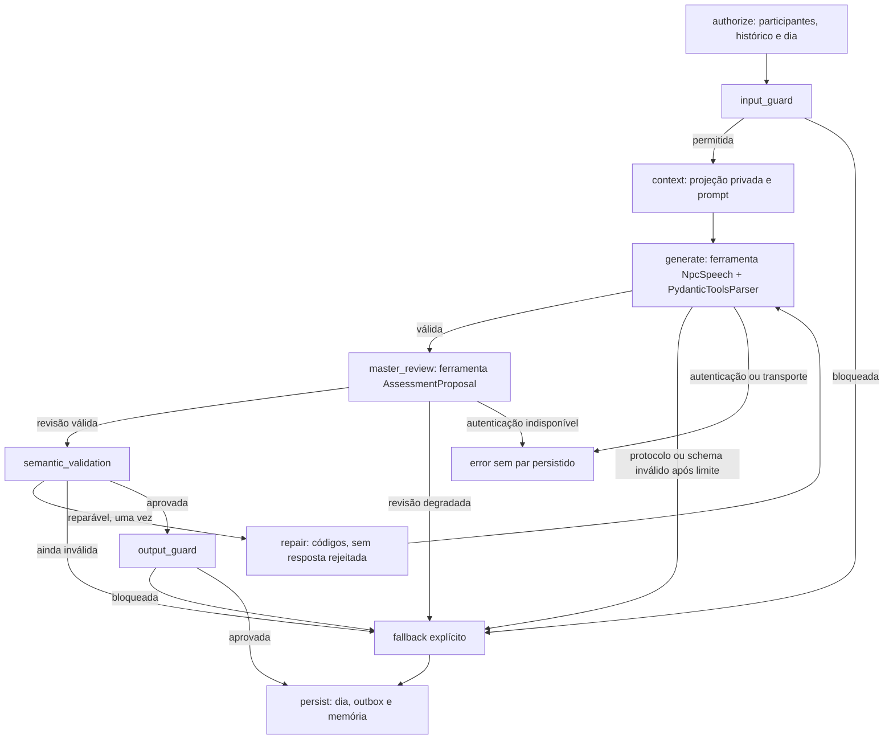

# Grafo de diálogo e prompts de persona

`src.modules.agents.service.HarnessService` é uma fachada de dependências.
`DialogueWorkflow`, em `src/modules/agents/workflow.py`, contém um `StateGraph`
compilado e executa uma troca por `ainvoke`, com estado novo por chamada.

Prompts de persona ficam em `src/prompts/dialogue.py`, usando `ChatPromptTemplate`
do langchain-core. O catálogo preserva biografias, vozes, objetivos, consciência do
papel e segredos. O servidor projeta somente o que o NPC pode conhecer. O marcador
`[task:npc_dialogue]` identifica a tarefa para clientes de avaliação; o schema viaja
como ferramenta do provedor, separado das instruções narrativas.

## Geração e limites

- O nó `generate` usa o ChatModel LangChain com
  `with_structured_output(NpcSpeech, method="function_calling")`. A proposta contém
  somente `fala`; a identidade vem do servidor. Tipos e campos adicionais são
  validados pelo `PydanticToolsParser`.
- Uma chamada nativa do DTO esperado é obrigatória. Texto ou JSON em `content`
  sem ferramenta não constitui sucesso. Não há parser textual, regex ou reparo de
  envelope nesta etapa. Consulte [saída nativa](saida_nativa_llm.md).
- Até duas tentativas de protocolo/schema por geração e um reparo semântico:
  no máximo quatro chamadas de fala. O mestre tem seu próprio orçamento; cada
  chamada continua passando pela medição existente.
- `tool_choice="auto"` é explícito. A emissão de ferramenta não é garantida pelo
  bridge; ausência ou nome incorreto termina em falha limitada e identificada.
- Reparos devolvem somente códigos autorizados e contexto original. A saída
  rejeitada não volta como mensagem assistant. A própria persona regenera sua fala;
  o mestre não escreve frases substitutas por ela.
- O turno tem prazo padrão de 60 segundos. Timeout e cancelamento não gravam um par
  parcial; um outbox já registrado continua reconciliável e idempotente.

## Sessões e efeitos

O grafo não guarda histórico entre invocações nem possui checkpointer paralelo.
Redis, gates por conversa/jogador, CAS e outbox permanecem responsáveis por
concorrência e consistência. Antes de gravar, o workflow revalida o dia e a sessão.
As trocas sociais seguem o grafo independente em `src/modules/social/graph.py`,
com leases adquiridos pelos próprios nós que escrevem.

Propostas do mestre não determinam culpa ou vitória. O motor confirma autoria,
citações, papel real e critérios canônicos antes de aceitar confissão ou qualquer
resultado. Relato útil continua sendo informação atribuída, não prova automática.

`ConversationMessage.generation_status` distingue `accepted`, `fallback` e
`guarded`. Fallbacks técnicos e respostas da guarda não alimentam extração,
fofoca, relato útil, confissão ou conquista. Auth indisponível retorna erro e
preserva o rascunho; falha esgotada de protocolo/qualidade produz resposta técnica
identificada como `dialogue-fallback`.

## Observabilidade e compatibilidade

Grafo e gerador desabilitam tracing externo por
`tracing_context(enabled=False, parent=False)`, inclusive com variáveis de ambiente
do host habilitadas. `DialogueTrace` registra IDs, nomes de nós, tentativas,
status e código de falha; não contém prompts, falas, bio ou papel secreto.
O evento `llm.dialogue.graph` é consultado pelo admin autenticado.

A gravação do diagnóstico é best-effort, com prazo independente de um segundo.
Ela não mascara a falha original nem bloqueia a resposta indefinidamente.
O leitor em `src/infrastructure/legacy_history.py` trata somente mensagens antigas
armazenadas; a geração nova exige ferramentas e não recupera JSON de texto. Os
históricos existentes não são reescritos.

## Verificação

Os testes executam o StateGraph e o Runnable reais, com clientes simulados e Redis
isolado, cobrindo reparo, erro nativo, autenticação, transição de dia, cancelamento,
concorrência entre partidas, privacidade de traces e propagação dos schemas de
ferramentas. Essa cobertura não equivale a uma inferência Qwen ao vivo: **o novo
protocolo ainda requer essa validação após renovar a credencial AWS**.

Referências oficiais: [StateGraph](https://reference.langchain.com/python/langgraph/graph/state/StateGraph)
e [saída nativa e limites do provedor](saida_nativa_llm.md).
