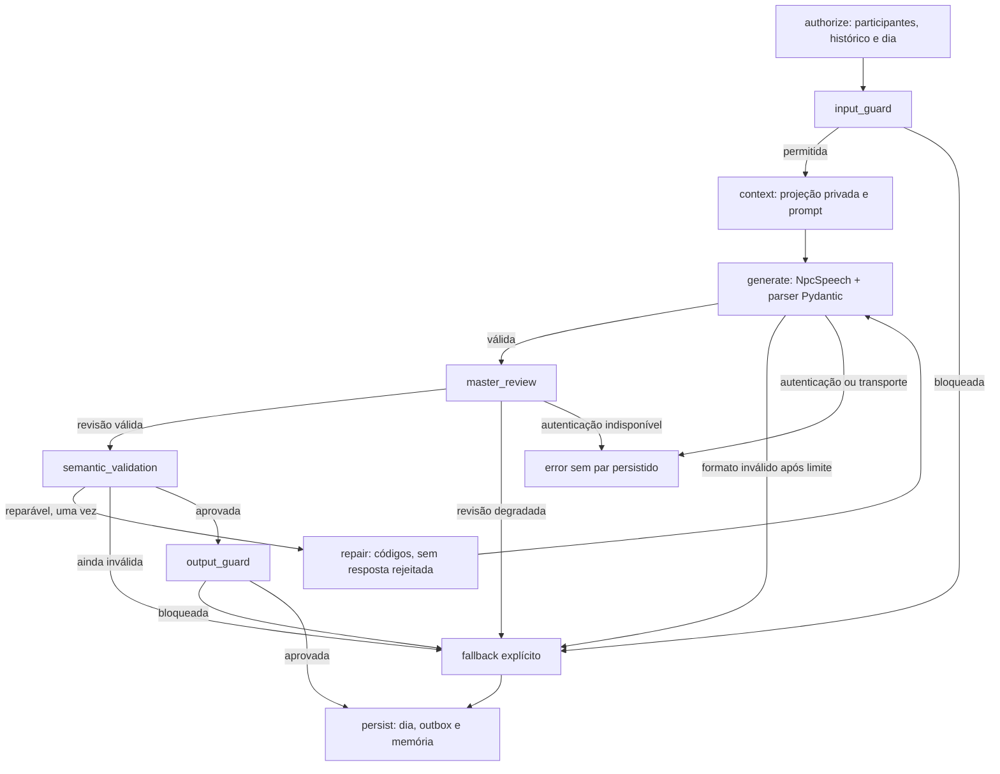

# Grafo de diálogo e prompts de persona

O `HarnessService` é uma fachada de dependências. `DialogueWorkflow` contém um
`StateGraph` compilado e executa uma troca por `ainvoke`, com estado novo por chamada.
Prompts de persona ficam em `prompts/dialogue.py`, usando `ChatPromptTemplate` do
langchain-core. O catálogo continua sendo a fonte das biografias, vozes e objetivos.
O marcador `[task:npc_dialogue]` identifica a tarefa para clientes de avaliação.

## Contratos e limites

- Geração nova aceita somente `NpcSpeech(fala: str)`, com campos extras proibidos,
  tipos estritos, conteúdo não vazio e limite de 8000 caracteres. A identidade do
  emissor vem do servidor, nunca da saída do modelo.
- Até duas tentativas de formato por geração e um reparo semântico: no máximo quatro
  chamadas de fala. O mestre possui seu próprio limite tipado; chamadas continuam
  passando pela medição existente.
- O turno completo tem prazo padrão de 60 segundos. Timeout gera `llm_timeout` e
  não grava um par parcial. Cancelamento externo continua sendo cancelamento.
- Autenticação indisponível retorna erro do serviço, preservando o rascunho. Falha de
  formato/qualidade esgotada produz resposta técnica identificada por
  `model=dialogue-fallback`. Guardas produzem `model=dialogue-guard`.
- Fallback não é relato útil, não autoriza narrativa e não gera confissão/conquista.
- Reparos nunca incluem a saída rejeitada como mensagem assistant. Apenas códigos
  de problema autorizados voltam ao modelo com o contexto original.
- O mestre avalia pertinência; semelhança lexical com um template não é condição
  obrigatória para publicar uma fala. Isso evita rejeitar voz própria por flexões
  como “estudamos” versus “estudaram”.

## Sessões, observabilidade e compatibilidade

A invocação desabilita tracing externo do LangSmith explicitamente, inclusive quando variáveis de ambiente o habilitam no host; apenas o trace sanitizado local é publicado.

O grafo não tem checkpointer próprio. O gate por conversa/jogador e o outbox
retomável permanecem responsáveis por concorrência e consistência. Antes de gravar,
o workflow verifica novamente se a conversa ainda pode acontecer naquele dia.

`trace_sink` recebe um `DialogueTrace` sanitizado por invocação: IDs, nomes de nós,
tentativas de geração/revisão, status e código de falha/fallback. Não contém prompt,
fala, bio ou papel secreto. `RedisDialogueTraceRecorder` publica o evento
`llm.dialogue.graph` no stream já consultado pelo admin. A gravação é best-effort,
com deadline independente de um segundo; falhas de diagnóstico não mascaram o erro
original nem bloqueiam a resposta indefinidamente.

`modules/agents/output.py` permanece somente como leitor de históricos anteriores:
aceita a prosa e o envelope legado exato, validando o remetente. Nenhuma geração nova
passa por essa normalização. Históricos existentes não são reescritos.

## Verificação

Os testes executam o StateGraph real com modelos simulados e Redis isolado,
cobrindo fluxo normal, reparo limitado, parsing inválido, autenticação, dia/noite,
timeout, cancelamento, duas partidas concorrentes e traces para o admin. Isso valida
o workflow e a persistência; não mede a qualidade narrativa do Qwen real.

Referência oficial consultada: [StateGraph e execução assíncrona](https://reference.langchain.com/python/langgraph/graph/state/StateGraph),
[arestas condicionais](https://reference.langchain.com/python/langgraph/graph/state/StateGraph/add_conditional_edges).
