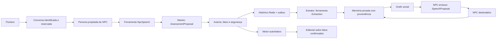
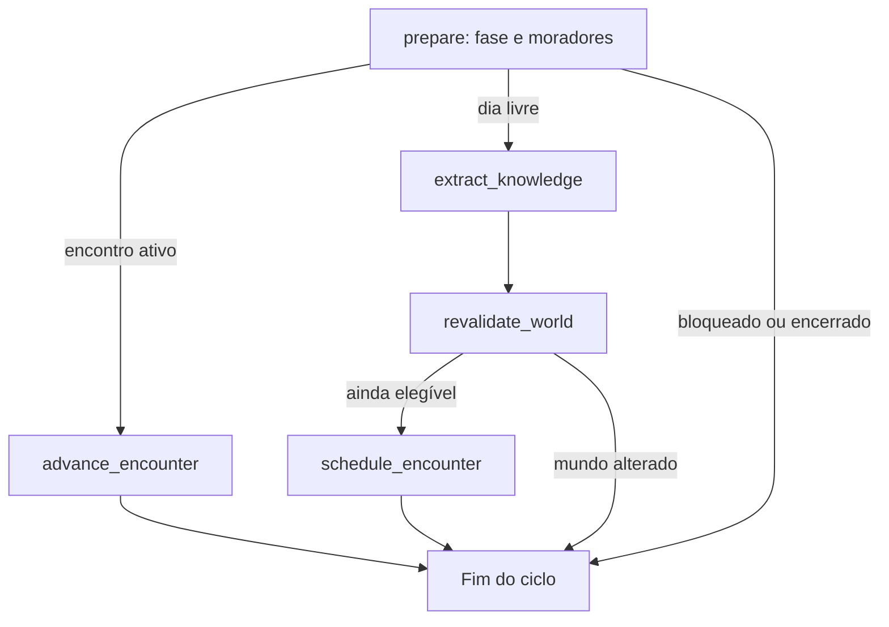

# Orquestração LLM: arquitetura atual

Esta é a referência atual dos agentes e sessões. A geração estruturada usa
**tool calling nativo**, `ChatModel.with_structured_output` e `PydanticToolsParser`;
a execução usa grafos LangGraph. O [plano consolidado](plano_refatoracao_llm.md)
registra as frentes e a substituição da proposta inicial de JSON por instruções.
Detalhes do provedor e fontes oficiais estão em [saída nativa](saida_nativa_llm.md).

## Responsabilidades e layout

| Camada | Implementação | Responsabilidade |
| --- | --- | --- |
| Transporte | `src/infrastructure/llm/bedrock_mantle.py` | HTTP Mantle, bearer temporário, prazo, envelope nativo e tokens |
| ChatModel e parser | `src/infrastructure/llm/structured.py` | `BaseChatModel`, ferramentas DTO, `with_structured_output`, `PydanticToolsParser` e tentativas limitadas |
| Contratos | `src/contracts/generation.py`, `assessment.py`, `src/modules/agents/schema.py` | Propostas Pydantic, tipos, campos e limites |
| Prompts | `src/prompts/` | Tarefa, voz/persona e contexto projetado, sem instruções de formato JSON |
| Diálogo | `src/modules/agents/workflow.py` | Sessão, revisão, reparo, fallback e persistência em LangGraph |
| Mestre | `src/modules/session_master/` | Parecer tipado, validação semântica e outbox |
| Convivência | `src/modules/social/graph.py`, `service.py` | Ciclo de relatos e encontros entre NPCs |
| Motor | `src/modules/turns/`, `src/modules/investigation/` | Crimes, provas, votos, prisão, dias/noites e desfecho |
| Persistência | Repositories Redis e gates | Memória, proveniência, CAS, exclusão mútua e efeitos idempotentes |

O código fica diretamente em `src/`, com imports `src.*` e entrypoint
`src.main:app`. `src/composition.py` injeta as dependências e `src/settings.py`
configura o ambiente. Não há pacote intermediário `memorias_licantropicas`.
`langchain-core` fornece ChatModel, prompts e parser; LangGraph organiza as etapas.
O pacote agregador `langchain` não é necessário. Versões ficam em `uv.lock`.

## Rede de agentes e sessões



Cada invocação tem estado novo associado à partida, conversa e NPC. Fichas privadas,
objetivos e segredos são projetados pelo servidor; um ator não recebe a memória
privada dos demais. O grafo compilado não guarda histórico entre chamadas.
Redis continua sendo a memória durável, com outbox para retomada e sem checkpointer
paralelo que duplique a autoridade sobre a sessão.

O [grafo de diálogo](grafo_dialogo_llm.md) explicita autorização, geração, revisão,
validação, reparo e persistência. O grafo social segue estes caminhos:



Nós que escrevem adquirem o próprio lease na tarefa asyncio que executa a operação.
Fencing, revisão CAS, dia ativo, reserva do jogador e presença dos moradores são
revalidados antes do commit. Inferência não concede autorização de escrita por si.

## Contratos nativos

| Tarefa | Proposta Pydantic |
| --- | --- |
| Fala da persona | `NpcSpeech`: somente `fala` |
| Mestre | `AssessmentProposal`: classificação, trechos, utilidade, problemas e entrega declarada |
| Extração | `Extraction`: até oito alegações com mensagem/fonte/trecho |
| Fala entre NPCs | `SpeechProposal`: fala, intenção e até duas alegações autorizadas |
| Assembleia | `AssemblyProposal`: emissores públicos, falas e força proposta do argumento |
| Editorial | `EditorialProposal`: opinião sobre fatos já resolvidos |

O schema é enviado em `tools` ao Mantle. O framework exige uma chamada nativa do
nome esperado, sem chamadas extras ou inválidas. JSON/texto em `content` não é
recuperado como proposta. Não há formatação de saída no prompt, regex, reparo de
cercas, parser de JSON parcial ou descarte silencioso de campos para obter sucesso.

Pydantic valida argumentos naturais do protocolo, com escalares estritos, limites e
campos adicionais proibidos. Tuplas/UUIDs wire possuem aceitação explícita de arrays
e strings em seus campos, sem alterar o parser do framework. Depois o domínio
confere autoria, citações literais, fontes, referências e disponibilidade.

A identidade vem do servidor. Campos internos como `source`, `attempts`,
`generation_status` e conquistas não são instruções aceitas do modelo.
`DialogueAssessment` e `PendingDialogueExchange` separam decisão e outbox das
propostas externas. O motor ainda valida a transição canônica antes de encerrar uma
partida por confissão, prisão ou assembleia.

O mestre identifica problemas; o grafo solicita que a própria persona regenere a
fala dentro do limite. As validações textuais usam operações explícitas e retornam
problemas, sem compor falas substitutas. Guardas conservadoras não certificam
verdade semântica nem proteção completa contra prompt injection.

## Falhas e privacidade

Uma geração aceita de uma a três tentativas, padrão duas. Protocolo/schema inválido
pode gerar nova chamada; auth, quota, credenciais, rede e timeout não recebem retry
indiscriminado. O reparo semântico do diálogo é limitado a uma regeneração.
Cancelamento e erros inesperados propagam. O prazo total padrão do diálogo é de
60 segundos; a persistência revalida a janela do dia.

Fallback técnico, resposta guardada e fala aceita têm estados distintos. Os dois
primeiros ficam no histórico, mas não alimentam extração, fofoca, relato útil,
confissão ou conquista. Extração sem transporte mantém cursor para nova tentativa;
extração inválida pode manter somente a transcrição literal. Falas sociais inválidas
não são transmitidas. Assembleia/editorial indisponíveis mantêm conteúdo determinístico
baseado no motor, sem fabricar novos fatos.

Cada tentativa passa pelo medidor. `completed` nele significa transporte concluído;
a aceitação da fala aparece separadamente no grafo e na mensagem. Tokens de dublês
não representam uso AWS. A persistência guarda apenas a fala canônica. Não há
leitor de envelopes antigos, importação de históricos ou migração de saves.

Grafos e gerador executam com `tracing_context(enabled=False, parent=False)`.
Variáveis LangSmith incidentais do host não exportam estado privado. O admin
consulta eventos locais sanitizados `llm.dialogue.graph`, com IDs, nós, tentativas,
status e códigos, sem prompts, falas, biografias ou papéis. O sink tem prazo
independente e sua falha não invalida uma resposta confirmada.

## Execução e alcance da validação

```sh
uv sync --locked
uv run uvicorn src.main:app --host 127.0.0.1 --port 7079
uv run pytest -q
uv run python scripts/run_session_simulations.py --games 10 --api-url http://localhost:7079 --max-live-calls 200
```

O [runner atual](simulacao_partidas_refatoracao.md) usa um agente LLM como Floriano
e a API pública da aplicação em execução. O servidor conserva autoridade sobre
sorteio, movimento, diálogos, convivência, relógio, provas e resultado. Não há
provedor offline no produto. O limite de chamadas do CLI cobre somente o agente
Floriano; consumo do servidor é separado. O agente recebe somente dados públicos.

Testes com MockTransport e Runnable real verificam protocolo, kwargs, validação,
medição, cancelamento e tracing. Relatórios de baterias anteriores preservam seus
commits de origem; não constituem evidência do caminho nativo posterior.
A [correção das conversas](correcao_ferramenta_dialogo.md) registra a verificação
real posterior com Qwen/Mantle. `tool_choice="required"` e uma instrução de conclusão
pela ferramenta substituem o modo opcional que causava fallbacks. Não há recuperação
de propostas a partir de texto livre nem garantia de confiabilidade total do modelo.

O workflow automático `Validate` permanece removido. Verificações são manuais e o
push continua com o usuário. Veja [saída nativa](saida_nativa_llm.md) e
[contratos](contratos_llm_estruturados.md) para os detalhes do protocolo.
