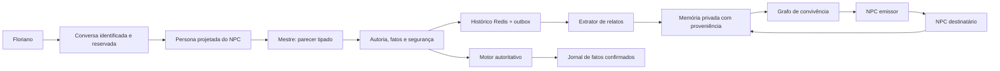
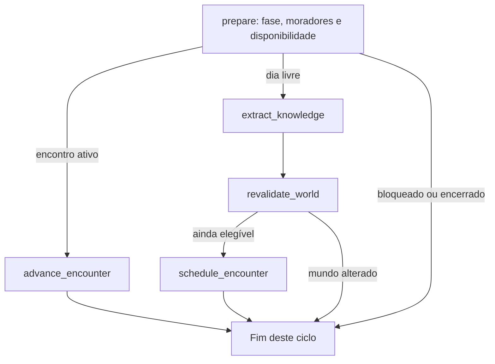

# Orquestração LLM: arquitetura atual

Esta é a referência atual do diálogo, das sessões e dos contratos de inferência.
O [plano de execução](plano_refatoracao_llm.md) registra a divisão das frentes.
Documentos das primeiras entregas permanecem como histórico do projeto.

## Separação de responsabilidades

| Camada | Implementação | Responsabilidade |
| --- | --- | --- |
| Transporte | `infrastructure/llm/bedrock_mantle.py` | HTTP, autenticação, prazo da chamada, envelope do provedor e tokens |
| Contratos de geração | `contracts/generation.py`, `contracts/assessment.py`, `modules/agents/schema.py` | Propostas Pydantic, campos permitidos, limites e tipos |
| Parser e tentativas | `infrastructure/llm/structured.py` | `PydanticOutputParser` do langchain-core, JSON completo, validação estrita e orçamento explícito |
| Prompts | `prompts/` | Instruções por tarefa, persona projetada pelo servidor e formato gerado pelo schema |
| Diálogo | `modules/agents/workflow.py` | Grafo LangGraph de uma troca, revisão, reparo, fallback e persistência |
| Mestre | `modules/session_master/service.py` e `validation.py` | Avaliar proposta, verificar autoria/citações e encaminhar decisão ao motor |
| Convivência | `modules/social/graph.py` e `service.py` | Extrair relatos, revalidar mundo, agendar/avançar encontros e confirmar falas |
| Motor | `modules/turns/`, `modules/investigation/` | Dias, crimes, prova, votos, prisão e resultado canônico |
| Persistência | Repositories Redis, gates e outbox | Histórico, exclusão mútua, CAS, retomada e efeitos idempotentes |

LangGraph representa as etapas e suas transições. `langchain-core` fornece o
`ChatPromptTemplate` de persona e o `PydanticOutputParser`; o pacote agregador
`langchain` não é necessário. As dependências e versões transitivas ficam em
`uv.lock`, instaladas com `uv sync --locked`.

## Rede de agentes e sessões



Cada execução tem estado novo, ligado a `game_id`, `conversation_id` e `npc_id`.
Um grafo compilado pode atender várias personas, sem guardar mensagens de uma
invocação na seguinte. As fichas preservam personalidade, objetivos, consciência
do papel e segredos autorizados; o modelo recebe somente a projeção daquele ator.
A rede social utiliza memórias com fonte, destinatário e origem rastreáveis.

O Redis continua sendo a memória durável. Não foi acrescentado um checkpointer
paralelo do LangGraph: dois registros independentes de uma mesma conversa exigiriam
uma estratégia de consistência que esta arquitetura não precisa.

O [grafo de diálogo](grafo_dialogo_llm.md) descreve os onze nós, as arestas e os
limites de reparo. O grafo de convivência tem os seguintes caminhos:



Nós que escrevem adquirem a própria reserva social, na tarefa asyncio que executa
a operação. Isso preserva o fencing por tarefa do repository; não se reutiliza o
lease de uma tarefa pai em nós filhos do LangGraph. CAS, fase, revisão do mundo,
reserva do jogador e presença dos moradores são revalidados antes do commit.

## Contratos externos e internos

Geração nova usa um documento JSON inteiro, validado pelo parser comum:

| Tarefa | Contrato externo |
| --- | --- |
| Fala da persona | `NpcSpeech`: somente `fala` |
| Parecer do mestre | `AssessmentProposal`: classificação, trechos literais, utilidade, problemas e entrega declarada |
| Extração | `Extraction`: até oito `ExtractedClaim` com mensagem/fonte/trecho |
| Fala entre NPCs | `SpeechProposal`: fala, intenção e até duas alegações autorizadas |
| Assembleia | `AssemblyProposal`: emissores públicos, falas breves e força proposta do argumento |
| Editorial | `EditorialProposal`: parágrafo de opinião sobre fatos já resolvidos |

A identidade do emissor vem do servidor. Campos como `corrected_reply`,
`discovery_ids`, `source`, `attempts` e `generation_status` não são aceitos como
instruções do modelo. `DialogueAssessment` contém os metadados internos e o
`PendingDialogueExchange` valida o outbox, inclusive autoria e identidade da sessão.

O parser rejeita prosa externa, cercas Markdown, JSON truncado, chaves duplicadas,
valores não finitos, campos extras e tipos inesperados. Um lote inválido é rejeitado
inteiro; não se removem campos ou elementos silenciosamente para torná-lo válido.
Após o parsing, o domínio verifica citações, IDs autorizados, fontes e disponibilidade.

A verificação de grounding emite códigos de problema. Ela não compõe uma fala
substituta. O mestre também não escreve pela persona: um problema de conteúdo ou
estilo leva a uma nova geração do próprio personagem, dentro do limite do grafo.
Guardas lexicais permanecem conservadoras e não constituem prova de equivalência
semântica ou proteção completa contra prompt injection.

A geração estruturada é solicitada por instruções do schema. A documentação
consultada não confirmou `response_format/json_schema` garantido para o par
Mantle Chat Completions + Qwen3 32B; a decisão e as fontes estão em
[contratos estruturados](contratos_llm_estruturados.md). O endpoint/modelo foi mantido.

## Erros, fallbacks e orçamento

| Situação | Comportamento |
| --- | --- |
| JSON/schema inválido na fala | Até duas tentativas por geração; ao esgotar, fallback técnico |
| Problema semântico reparável | Uma regeneração da persona; sua nova saída passa novamente pelas validações |
| Autenticação, rede, quota ou timeout de transporte | Erro sanitizado, sem repetição indiscriminada; sem inventar resposta bem sucedida |
| Revisão indisponível | Fallback explícito, ou erro de autenticação; não publica a fala livre sem revisão |
| Extração indisponível | Cursor preservado para nova tentativa dentro da cota diária |
| Extração malformada | Retém transcrição literal, sem promovê-la a relato compartilhável |
| Fala social inválida | Encontro termina sem mensagem ou transmissão de alegações inválidas |
| Assembleia/editorial indisponível | Mantém falas/fatos determinísticos já aprovados pelo motor |
| Bug interno inesperado | Propaga; não é convertido silenciosamente em resposta vazia |

`ConversationMessage.generation_status` diferencia `accepted`, `fallback` e
`guarded`. Os dois últimos permanecem no histórico para mostrar o que aconteceu,
mas não alimentam o extrator nem a rede de fofocas. Também não são relatos úteis,
confissões ou conquistas. Registros antigos sem esse campo usam o valor padrão
`accepted`; a guarda legada continua protegendo sua apresentação.

O prazo total padrão é `LLM_TURN_TIMEOUT_SECONDS=60`, incluindo contexto, geração,
revisão, reparo e persistência. Os gates recebem uma margem adicional de quinze
segundos. O prazo por chamada continua em `LLM_TIMEOUT_SECONDS`. Cancelamento
propaga, e um outbox já gravado pode ser reconciliado sem duplicar efeitos.
Cada tentativa passa pelo cliente medido, mesmo quando a resposta é rejeitada.

O parser de envelope antigo em `modules/agents/output.py` permanece isolado para
ler histórico anterior. Ele não participa da geração nova. O antigo `json_output.py`
e os sintetizadores `_authored_voice`, `supported_reply` e `has_useful_anchor` foram
removidos após verificar seus consumidores. Benchmarks e relatórios históricos
foram preservados porque possuem imports e experiências reproduzíveis associados.

## Observabilidade e privacidade

O admin autenticado pode consultar os eventos `llm.dialogue.graph`, com IDs,
nomes de nós, tentativas e códigos/status. O gravador não cria streams para partidas
inexistentes e tem prazo independente de um segundo. A falha desse diagnóstico
não invalida uma resposta já confirmada. O contrato administrativo projeta os
campos explicitamente e inclui `generation_status`.

Tracing externo do LangSmith é desabilitado explicitamente nos dois grafos,
inclusive se variáveis de ambiente do host o habilitarem. Prompts, biografias,
falas e papéis secretos não fazem parte dos traces técnicos locais. Os testes
proíbem criar o tracer externo mesmo com essas variáveis ativadas.

## Execução e validação

```sh
uv sync --locked
uv run pytest -q
uv run python scripts/run_session_simulations.py --games 100 --seed 20261105
# Opcional: mesmo motor contra Redis real, em namespace isolado.
uv run python scripts/run_session_simulations.py --games 100 --seed 20261105 \
  --redis-url redis://127.0.0.1:16389/0 --output artifacts/simulations/sessions.json
```

O runner compõe os mesmos serviços usados pela API. Cria partidas com sorteio,
anda, conversa, registra álibis por fala natural, extrai relatos, faz moradores
interagirem, busca e apresenta pistas, acusa ou convoca a assembleia e resolve
noites até vitória/derrota. A política só vê projeções públicas; o culpado é lido
após o encerramento para auditoria. Também cruza mensagens técnicas e descendentes
da memória para abortar qualquer promoção indevida de fallback/guarda.

O modo padrão usa provedor simulado e não chama AWS. O modo real exige `--live`,
perfil e cota explícitos; não foi executado nesta entrega. Resultados, custo real
zero e limites de interpretação estão em [partidas completas](simulacao_partidas_refatoracao.md)
e no [relatório JSON](reports/session_refactor_100.json).

As validações locais foram executadas manualmente. O workflow automático `Validate`
continua removido, conforme a decisão anterior. O push permanece com o usuário.

### Evidências desta entrega

- **837 testes backend aprovados**, com sete subtests, contra Redis real em namespace por teste.
- **56 testes frontend aprovados**, com TypeScript e build Vite concluídos.
- **Seis testes no Brave aprovados**: ciclo real do servidor, exploração, conversa pela API,
  retomada, admin autenticado, caminhos do cenário e texto malicioso tratado como texto.
- Imagens finais reconstruídas e pilha Docker isolada saudável, com checagem de CSP,
  bloqueio do admin público e login/logout do painel privado.
- `uv lock --check`, `git diff --check` e `actionlint` aprovados. A suíte de validação
  automática continua removida; estas foram execuções manuais desta refatoração.
- **100 partidas completas com Redis real**, 75 vitórias e 25 derrotas. Foram auditados
  4.398 pares, incluindo 292 fallbacks e 584 IDs técnicos: **zero contaminação da memória**.
  Uma partida adicional verificou o caminho `guarded` com o mesmo resultado.
- **Zero chamadas AWS e custo real AWS US$ 0**. Tokens dos dublês são aproximações;
  as políticas exaustivas e o provedor simulado não validam equilíbrio humano ou fluência Qwen.

A bateria de partidas referencia o commit de código `14bebb7`; o relatório compacto
inclui hash do artefato completo para verificar integridade. Os artefatos temporários
completos foram gerados em `/tmp` e a evidência versionada está em `docs/reports/`.
Os contêineres e volumes descartáveis foram removidos; as partidas locais existentes
não foram apagadas. A publicação remota permanece manual.
