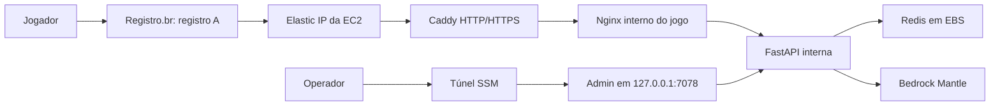

# Solução na AWS

A publicação usa um registro A manual no Registro.br apontando para um Elastic IP exclusivo do jogo. Caddy executa na EC2, obtém e renova o certificado automaticamente e encaminha requisições ao Nginx público pela rede Docker interna. A [reprodução](reproducao_aws.md) descreve a sequência operacional.

## Terraform e persistência

| Raiz | Responsabilidade |
| --- | --- |
| `bootstrap` | VPC com DNS, IGW, duas subnets públicas, rotas, EIP persistente, EBS, buckets S3, ECR, IAM/OIDC e documentos SSM; mantém também ACM/Route53 legados |
| `app` | EC2 `m7i-flex.large`, security group público 80/443, associação do EIP e anexo do EBS |

O bootstrap publica `foundation.elastic_ip`, `elastic_ip_allocation_id` e `caddy_image`. A EC2 e o EBS ficam na subnet/AZ primária. O EIP pertence à base permanente, com `prevent_destroy`: destruir apenas app desassocia o endereço, mas não o libera.

O state S3 continua separado em `bootstrap/terraform.tfstate` e `production/terraform.tfstate`, com lock, criptografia e versionamento. O assistente `scripts/bootstrap_aws.py` confere identidade, inventário, OIDC e states antes de planejar/aplicar; nunca substitui um state divergente automaticamente.

## Rede e certificados

Somente 80 e 443 TCP entram pelo security group. Não há SSH público. API, Redis e Nginx do jogo não publicam portas no host. O admin publica somente `127.0.0.1:7078` e exige sessão autenticada depois do túnel SSM.

Caddy usa a imagem oficial linux/amd64 fixada por digest, usuário sem privilégios, filesystem somente leitura, capabilities removidas e bind de portas baixas permitido apenas em seu namespace de rede. HTTP redireciona para HTTPS; HTTP/3 não é publicado. O listener de saúde 8081 fica no loopback do container.

`/data` e `/config` do Caddy são montados em `/srv/ml-data/caddy/{data,config}`, no EBS persistente. A conta ACME, chaves e certificados sobrevivem a reinícios e substituições da EC2. Não apague esse diretório para corrigir erros de DNS: isso pode perder a conta/chaves e provocar novas emissões.

Caddy não usa credenciais de DNS ou plugins de Registro.br. A emissão usa os desafios públicos ACME; o registro A deve apontar para o EIP e as portas 80/443 devem estar acessíveis. Remova AAAA antigo do mesmo hostname se não houver IPv6 configurado. Veja a [documentação oficial de HTTPS automático](https://caddyserver.com/docs/automatic-https).

A rede `edge` dá saída HTTP/HTTPS somente ao Caddy e bloqueia IMDS/host. Nginx/admin ficam em `frontend`; somente Caddy pode informar a Nginx o IP original, sobrescrevendo X-Forwarded-For. A API usa sua rede de saída fixa para AWS/Mantle; Redis fica somente em `backend`. O firewall e os limites de requisições continuam ativos.

## Entrega

GitHub Actions assume roles por OIDC. O delivery constrói imagens API/web no ECR, com tags imutáveis de commit e referências por digest, verifica o scan e grava `releases/COMMIT.json` no S3. O manifesto contém apenas versão e imagens; não contém senha ou arquivos arbitrários de host.

O documento SSM recebe somente o commit. Cloud-init instala arquivos fixos, prepara EBS/firewall e systemd. O instalador valida o manifesto e os digests, obtém a senha por SecureString, inicia Redis/API/Nginx/admin/Caddy e verifica a saúde interna. Depois o delivery confere se DNS resolve exclusivamente para o EIP e aguarda HTTPS com certificado confiável e resposta de saúde válida.

Se DNS/certificado ainda não estiver pronto, o delivery falha com indicação da configuração pendente; a instalação interna pode já ter terminado. Consulte os logs antes de repetir. Rollback de imagens não reverte dados ou certificados.

## Recursos legados e limites

O certificado ACM, CNAME de validação e zona Route53 já aplicados permanecem na raiz bootstrap, com os mesmos endereços Terraform. Nenhuma emissão/validação ACM, delegação NS, ALB ou alias Route53 é necessária na raiz app.

Caso um state app antigo contenha ALB/listeners/alias ou uma EC2 que precise ser substituída, o workflow recusa o plano de apply comum por conter remoções/substituições. Uma migração/limpeza deve ser preparada separadamente, com backup e revisão. A configuração não apaga esses recursos na conta sem essa decisão. Não use remoção de state como atalho.

O ambiente é uma única EC2; EIP e EBS não fornecem alta disponibilidade. Redis usa AOF everysec e não substitui backup externo. A senha administrativa permanece em Parameter Store e é montada em arquivo somente leitura na API.
