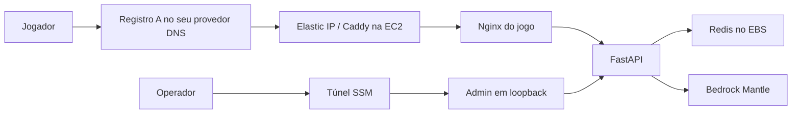

# Arquitetura AWS

A publicação usa uma única EC2 com um Elastic IP. O domínio aponta para esse
endereço, o Caddy cuida do HTTPS e encaminha o tráfego ao Nginx do jogo. A API
e o Redis ficam na rede interna, sem acesso direto pela internet.

Escolhi esta estrutura para experimentar provisionamento e entrega contínua sem
misturar os dados das partidas com a instância da aplicação. Para reproduzi-la,
veja o [guia de reprodução na AWS](reproducao_aws.md).

## Infraestrutura e persistência

O Terraform tem duas partes:

| Raiz | O que mantém |
| --- | --- |
| `bootstrap` | Rede, duas subnets públicas, Elastic IP, EBS, buckets, ECR, IAM/OIDC e documentos SSM |
| `app` | EC2, security group, associação do IP e anexo do disco |

A instância padrão é `m7i-flex.large`. Ela fica na mesma zona do EBS. O disco
guarda Redis e certificados do Caddy; substituir a instância não deve apagar
esses dados. O Elastic IP pertence à base e continua reservado sem a EC2.

O state fica no S3, com criptografia, versionamento e lock. As chaves separam
`bootstrap/terraform.tfstate` de `production/terraform.tfstate`. O assistente
confere a conta, os recursos e os states antes de aplicar mudanças.

## Acesso e HTTPS

Só HTTP e HTTPS entram publicamente. Não há SSH aberto. O admin fica em
`127.0.0.1:7078` no host e exige túnel SSM mais login. O painel consulta partidas,
visitas e consumo de IA sem executar ações no jogo.

Caddy emite e renova o certificado com desafios públicos ACME. Para isso, o DNS
precisa apontar para o Elastic IP e as portas 80/443 devem estar acessíveis.
Os certificados ficam em `/srv/ml-data/caddy` no EBS. Não os apague para resolver
um problema de DNS.

As redes Docker separam a entrada pública, os proxies, a API e o Redis. O firewall
limita as saídas e bloqueia acesso indevido aos metadados da EC2. Os containers
também têm restrições de usuário, filesystem e permissões.

## Publicação e atualização

O GitHub Actions assume roles por OIDC, sem chaves AWS permanentes no repositório.
A entrega constrói as imagens, verifica o scan ECR e usa os digests para identificar
exatamente o que será instalado. O manifesto de cada commit vai para o S3.

O SSM recebe o commit e aciona o instalador. Ele confere o manifesto, busca a
senha no Parameter Store e inicia os serviços. O workflow termina verificando
DNS e saúde por HTTPS. As imagens web já incluem compressão, cache e recursos
otimizados.

Se HTTPS falhar, a instalação interna pode ter terminado. Confira os logs antes
de repetir a entrega. Voltar uma imagem não reverte os dados do Redis.

## Modelo de IA e limites

A aplicação usa o **Qwen3-32B (`qwen.qwen3-32b`)** pelo **Amazon Bedrock Mantle**
em `us-east-1`. Usei créditos AWS no desenvolvimento, mas a instalação e a
inferência podem gerar cobranças na conta de quem reproduzir o projeto.
O backend não traz integração pronta para Ollama ou LM Studio: executar a
aplicação em uma EC2 ou no computador não torna o modelo local. A saúde da API
não garante acesso ao Bedrock; a validação exige uma conversa real.

Essa arquitetura usa uma única EC2: EBS e Elastic IP não oferecem alta
disponibilidade. Redis usa AOF, mas ainda precisa de uma política de backup.
Os recursos permanentes continuam gerando custos quando a aplicação é removida.

A base ainda mantém recursos ACM e Route53 da arquitetura anterior, embora o
caminho público atual não dependa deles nem de ALB. Se houver esses recursos no
seu state, trate sua remoção em um plano separado. O fluxo comum bloqueia
remoções e substituições; não remova entradas do state como atalho.
