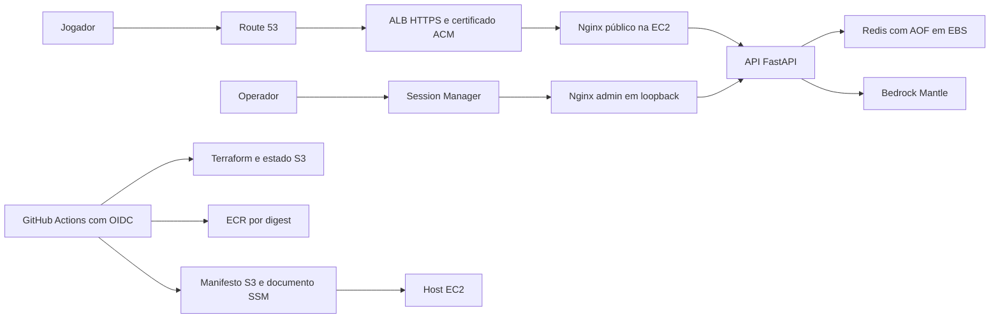

# Solução na AWS

Este documento descreve a infraestrutura versionada em `infra/terraform/`, `deploy/production/` e `.github/workflows/`. Não é um inventário consultado da conta nem comprova que um deploy foi executado. O procedimento operacional está em [reprodução na AWS](reproducao_aws.md); a lógica dos personagens está em [orquestração dos agentes](orquestracao_agentes.md).

## Arquitetura

O bootstrap cria uma VPC própria com DNS, Internet Gateway, duas sub-redes públicas em zonas distintas e rotas para a internet. Os padrões são `10.42.0.0/16`, `us-east-1a` e `us-east-1b`. A instância Amazon Linux 2023 `m7i-flex.large` usa a subnet primária, na mesma AZ do EBS. Ela tem IP público para saída e recebe tráfego de aplicação somente do security group do ALB na porta 8080. Não há ingresso SSH.

O ALB redireciona HTTP para HTTPS, usa certificado ACM e verifica `/health`. O domínio configurado é `memoriaslicantropicasgame.gustavodreis.dev.br`. A zona Route 53 desse subdomínio exige delegação no DNS do domínio pai.

## Separação do Terraform

| Raiz | Recursos e ciclo de vida |
| --- | --- |
| `infra/terraform/bootstrap` | Fundação persistente: VPC/subnets/rotas/IGW, estado/releases S3, ECR, DNS, ACM, EBS, identidades OIDC/IAM, perfil da instância e documentos SSM |
| `infra/terraform/app` | Aplicação substituível: instância, ALB, target group, security groups e registro DNS de acesso |

O assistente `scripts/bootstrap_aws.py` conduz `plan`, `apply` e `configure`, conferindo identidade, recursos, state e subject OIDC. A primeira execução começa com estado local e depois migra para `bootstrap/terraform.tfstate` no bucket S3 criado. As seguintes reutilizam esse state. A aplicação usa `production/terraform.tfstate` e consulta os outputs da fundação por remote state. O backend usa criptografia, versionamento e lockfile S3. O output `foundation` publica a VPC, as duas subnets e a subnet específica da instância; não são mais entradas manuais.

O EBS de dados é criptografado e tem proteção contra destruição no bootstrap. Ele fica na mesma zona da instância e monta em `/srv/ml-data`. O disco raiz da EC2 é separado e descartável. Destruir apenas a raiz `app` preserva os dados e a fundação; não elimina todos os recursos ou custos da conta.

## Containers e persistência

A API também aplica limites por IP em cada processo: 20 requisições/s com rajada de 40, criação de partidas 6/min com rajada de 6 e mensagens 30/min com rajada de 5. Retorna 429 com `Retry-After`. Corpos têm limite de 16 KiB e prazo de 10 segundos. Três tentativas de caminhos de exploração conhecidos, corpo excessivo ou corpo lento causam bloqueio de dez minutos. O texto narrativo não é usado para detectar ataques. O login mantém sua proteção específica contra força bruta.

`SECURITY_TRUSTED_PROXIES` permite aceitar um único IP válido em `X-Forwarded-For` somente dos proxies configurados. Na produção, confia na rede Docker do Nginx, que sobrescreve o cabeçalho público; fora dela usa o endereço da conexão. O controle mantém até 10 mil clientes, é local ao processo e reinicia com ele. Uma futura implantação com várias réplicas exige um contador compartilhado. Os limites do Nginx continuam como proteção adicional na borda.

`deploy/production/compose.yaml` define API, Redis, frontend público e frontend administrativo. As imagens da API e da web vêm do ECR por digest. O Redis usa uma imagem fixada por digest pela fundação.

| Serviço | Exposição e função |
| --- | --- |
| Web | Porta 8080 do host, acessível pelo ALB; bloqueia admin e documentação da API |
| API | Porta 8000 interna; serve jogo e rotas autenticadas do admin |
| Redis | Rede interna; AOF `everysec` no EBS, limite de memória e política `noeviction` |
| Admin | Apenas `127.0.0.1:7078`, acessível por túnel SSM |

Os containers usam usuário sem privilégios, filesystem somente leitura, `cap_drop: ALL`, `no-new-privileges`, tmpfs e limites de memória/logs. As redes separam backend e saída. O firewall do host aplica as restrições de saída e de acesso aos metadados definidas em `container-firewall.sh`.

Redis guarda partidas, mesa, memórias, relações, sessões administrativas e métricas. O AOF e o EBS sobrevivem à substituição da aplicação, mas isso não constitui uma política de backup externo. A configuração não fornece alta disponibilidade do Redis ou de múltiplas instâncias da API. AOF `everysec` também não equivale a confirmação de cada gravação em disco.

## Identidade e segredos

GitHub Actions assume roles por OIDC; não usa access keys estáticas. As políticas restringem repositório, ambiente e operações. A implementação está vinculada a `Gusreis7/MemoriasLicantropicasGame` e ao domínio indicado acima; mudar somente um `.tfvars` não adapta toda a solução para outro proprietário.

A EC2 usa instance profile para ECR, releases S3, SSM, leitura do parâmetro administrativo e acesso ao modelo Bedrock/Mantle. O Compose de produção usa credenciais padrão da instância, sem copiar `.aws` do desenvolvedor.

A senha administrativa é um `SecureString` em `/memorias-licantropicas/production/admin-password`. O deploy a materializa em `/run/ml-game/admin_password`, montado na API como arquivo somente leitura. Ela não é variável Terraform, conteúdo de manifesto ou segredo entregue ao frontend.

## Entrega e recuperação

O workflow `infrastructure.yml` oferece `plan`, `apply` e `destroy` da raiz `app`, com roles e ambientes separados. O bootstrap e a delegação DNS são preparados antes desse fluxo. A destruição exige confirmação do domínio.

O workflow `delivery.yml` executa em `main` e pode ser iniciado manualmente. `scripts/deliver_aws.py` constrói imagens `linux/amd64`, usa o commit completo como tag imutável, espera a análise do ECR e rejeita achados altos ou críticos. Um manifesto com digests é salvo em S3 e um documento SSM fixo recebe somente o commit a instalar.

No host, `ml-deploy.py` valida o manifesto e os repositórios permitidos, serializa a operação por lock, obtém a senha no SSM e aplica o Compose. Se a aplicação falhar na verificação, tenta restaurar as imagens anteriores. Esse rollback não restaura Redis nem desfaz alterações de formato dos dados.

O workflow de entrega valida a construção e a compilação Python; não executa toda a suíte de backend e frontend. Execute os [testes](testes.md) antes de integrar mudanças. Os testes Terraform e de segurança locais verificam a configuração; não comprovam permissões efetivas nem conectividade em uma conta real.
